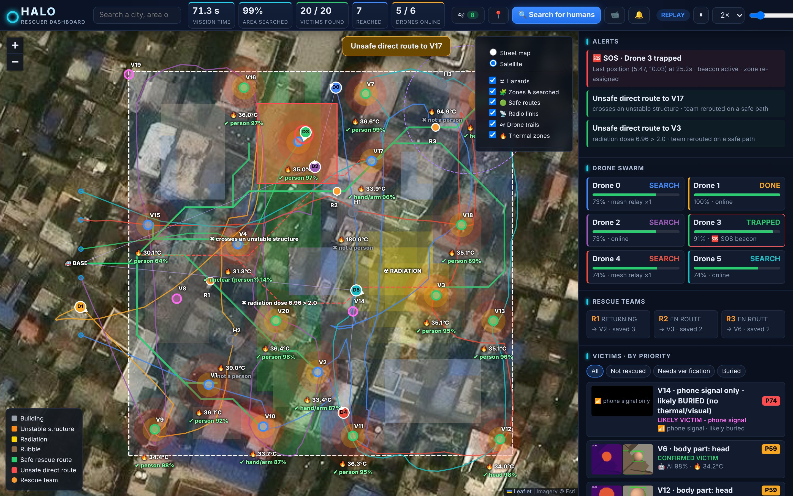
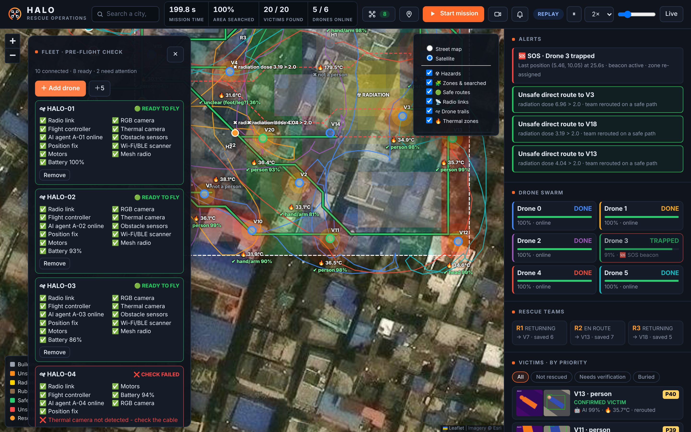
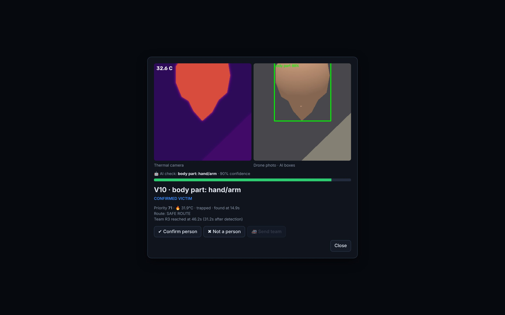
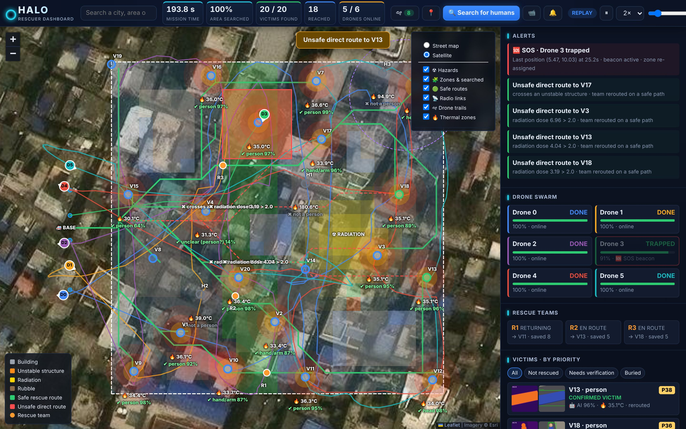
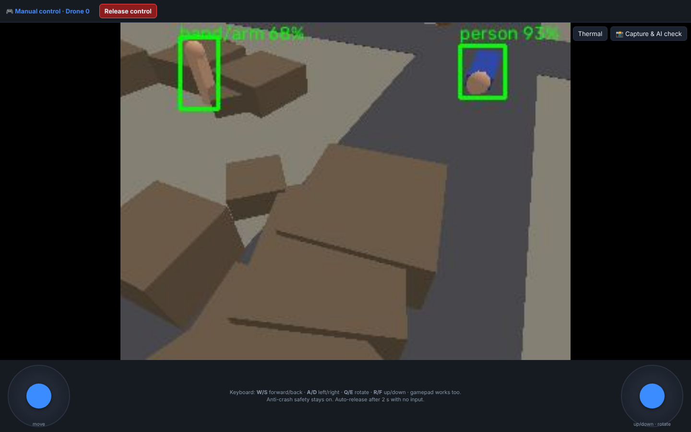
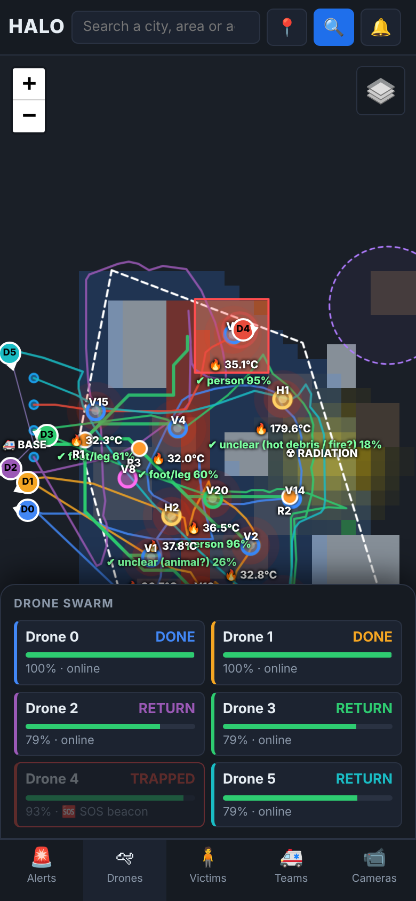
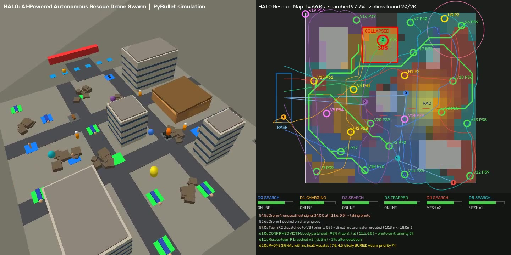

<div align="center">

# 🛰️ HALO
### Hazard-Aware Lifesaving Operations

**An autonomous AI drone swarm that finds trapped people after disasters and guides rescuers to them safely.**


-f59e0b)


*Physical AI Hackathon: From Simulation to Reality · Disaster Management (Robotics + AI)*



<sub>Rescuer dashboard during a live mission: swarm zones, drone flight paths, thermal hotspots with AI verdicts and hazard-aware rescue routes on satellite imagery.</sub>

[Results](#-results) · [Dashboard](#-rescuer-dashboard) · [How it works](#%EF%B8%8F-how-it-works) · [AI](#-the-ai) · [Quick start](#-quick-start) · [Sim-to-real](#-from-simulation-to-reality)

</div>

---

## 🚨 The problem

The first **72 hours** after an earthquake, flood or building collapse decide who survives. Search and rescue is still mostly manual:

- Teams search **zone by zone on foot**, which is slow and dangerous.
- Survivors are often **mostly buried**: only a hand or foot is visible, or nothing at all.
- Rescuers walk in **without knowing** about radiation, unstable buildings or the safest way in.
- **Mobile networks fail**, cutting communication when it matters most.

## 💡 The solution

A rescuer adds drones, draws the disaster area on a satellite map and presses **Search for humans**. HALO then:

1. **Splits the area** evenly across the swarm, and re-splits it whenever a drone recharges, gets trapped or rejoins.
2. **Searches every zone in parallel**, with thermal cameras and phone-signal scanners.
3. **Checks every heat signal with AI** (YOLOv8) for whole people *or* partial body parts, and never discards one.
   Drones are flown by a **pilot trained with reinforcement learning**, kept safe by an anti-crash shield.
4. **Plans a hazard-free route** to each victim and **sends rescue teams**, most urgent first.
5. **Streams it all live** to a dashboard that runs on a laptop or as an app on a phone.

---

## 📊 Results

One simulated earthquake-hit city block (~100 m at 1:8 scale) with **20 hidden victims** (7 partly buried, 3 fully buried), **3 heat decoys** (fires and an animal) and **3 rescue teams**. HALO works with **any number of drones**; this benchmark used 6.

<div align="center">

| 🎯 Victims found | 🚑 Reached by teams | 🤖 AI detection | ⚡ vs one drone |
|:---:|:---:|:---:|:---:|
| **20 / 20** | **20 / 20** | **16 / 17 people · 0 / 3 decoys** | **3.2× faster** |

</div>

| Metric | Result |
|---|---|
| Area searched | **100 %** in 117 s, despite one drone trapped and one recharging |
| First victim found | **3.9 s** · all visible victims by **64 s** |
| Partial-body victims (hand / foot / head) | **7 / 7** found |
| Buried victims found by phone signal only | **3 / 3** (location error 0 – 1.1 m) |
| Heat signals discarded | **0**. The one person the AI was unsure about went to a rescuer, who confirmed it from the photo |
| Decoys | **3 / 3** recognised as *not a person* |
| Avg. time from detection to a team reaching the victim | **73 s** |
| Drone crashes (flown by the learned RL pilot) | **0** |
| Unsafe direct routes caught and rerouted | **3** (radiation, unstable building) |

**Swarm vs single drone** (same scene, classic pilot): full search **98 s vs 298 s**, all visible victims **64 s vs 203 s**.

---

## 🖥️ Rescuer dashboard

A web app for the rescue team that also installs as a phone app. All data stays on the rescue team's laptop.

<table>
<tr>
<td width="50%"><br><b>Fleet setup.</b> Add any number of drones. Each one loads its own AI pilot agent and runs a live pre-flight check until it shows 🟢 READY TO FLY. Failed checks show the reason and a Retry button.</td>
<td width="50%"><br><b>AI victim check.</b> Thermal image and drone photo side by side, with YOLOv8's boxes, its confidence, and Confirm / Not a person / Send team buttons.</td>
</tr>
<tr>
<td><br><b>Rescue routes.</b> Each new safe route (green) draws itself across the map from the base to the victim. Unsafe direct routes (red dashed) are labelled with the reason: radiation dose or an unstable structure.</td>
<td><br><b>Live camera wall.</b> Watch one, several or all online drones at once, in normal or thermal view, with AI boxes on people. Watching never changes what the drone does.</td>
</tr>
<tr>
<td><br><b>Manual takeover.</b> Fly any drone with keyboard, touch joystick or gamepad. The anti-crash filter stays on, so a person can't fly it into a wall or another drone.</td>
<td><br><b>Phone app (PWA).</b> Add it to the home screen on Android or iPhone. The map goes full screen and the panels become tabs.</td>
</tr>
</table>

**Also in the dashboard:** place search (fly to any city) · satellite or street map · draw the search area (rectangle or polygon) · set the rescue base · live KPIs · alerts with sound (SOS, heat signal being checked, photo needs verifying, unsafe route) · drone cards (battery, state, online / mesh relay / offline-autonomous) · recall a drone · victim filters · event feed · full mission replay with timeline.

---

## ⚙️ How it works

```
                          ┌──────────────────────────────┐
  Rescuer (web / phone) ◄►│  HALO Command AI  (base)     │◄── fleet: N drones, one agent each
                          │  zones · priorities · teams  │
                          └──────────────┬───────────────┘
                           mesh radio    │   (may drop out)
          ┌──────────────┬──────────────┼──────────────┬──────────────┐
     ┌────▼────┐    ┌────▼────┐    ┌────▼────┐    ┌────▼────┐    ┌────▼────┐
     │ Agent 1 │    │ Agent 2 │    │ Agent 3 │    │ Agent 4 │    │ Agent N │
     └────┬────┘    └─────────┘    └─────────┘    └─────────┘    └─────────┘
          │  Perceive → Decide → Act   (keeps working on its own when the link drops)
          ▼
   Thermal · RGB camera + YOLOv8 · Wi-Fi/BLE scanner · rangefinders · radiation sensor
```

| | |
|---|---|
| **Smart zone splitting** | The area is split evenly and matched to drones with the Hungarian algorithm. Works for any fleet size. |
| **Self-healing swarm** | When a drone is trapped, recharging, recalled or rejoins, all unsearched cells are re-split automatically. |
| **Battery-aware agents** | Each agent works out when it must head home, recharges on its pad and rejoins the search. |
| **Collision-free flight** | A* paths around buildings, a separate altitude layer per drone, vertical deconfliction, and an anti-crash filter (16 rangefinder rays, 0.4 m obstacle margin, 0.5 m drone separation, geofence) for manual flight. |
| **Edge autonomy + mesh relay** | Out of base range, drones relay through each other. In radio dead zones they keep searching and sync when they reconnect. |
| **Drone SOS beacon** | A drone trapped in an aftershock collapse sends its last position, and the swarm takes over its zone. |
| **Phone-signal locating** | Wi-Fi/BLE signal strength from every drone is pooled into a least-squares fit, which finds buried people with no heat or visual contact. |
| **Priority scoring** | Ranks victims by AI certainty, how trapped they are, nearby hazards and body temperature. |
| **Safe-route planning** | Hazard-weighted A* for rescuers that avoids radiation, unstable structures and rubble. Victims inside a collapsed building get a perimeter route and a heavy-rescue flag. |



<sub>The PyBullet simulation (gym-pybullet-drones quadcopter physics) with the swarm's live map. Full recording: <a href="simulation/results/halo_demo.mp4"><code>halo_demo.mp4</code></a></sub>

---

## 🤖 The AI

**Victim detection: YOLOv8n, trained by us.** Real disaster photos with labelled body parts in rubble are scarce, so `simulation/train_vision.py` makes its own training data. It renders **900 randomised drone photos** in PyBullet: people, hands/arms, feet/legs and heads in rubble, plus look-alike decoys (fires, animals, debris). Heights, angles, light, skin, clothing and ground colours are all random, and the boxes come straight from the segmentation mask, so labels are exact even when objects are partly hidden. YOLOv8n (COCO-pretrained) is then fine-tuned on these photos.

| Validation | mAP50 | mAP50-95 |
|---|---|---|
| Person | 0.82 | |
| Body part (hand / foot / head) | 0.91 | |
| **All** | **0.87** | **0.80** |

In the full mission it found **16 of 17** visible people at ≥ 50 % confidence and called **none** of the 3 decoys a person. The camera verdict is fused with the thermal reading, so anything far hotter than a body (a fire at 180 °C) can't be marked as a confirmed person. The one it missed (a foot, 16 %) still went to a rescuer, because of HALO's rule: **no heat signal is ever discarded.** Confidence ≥ 85 % is a confirmed victim, 50–85 % is likely, and anything below goes to a rescuer to verify.

**Learned pilot: trained with reinforcement learning.** `simulation/pilot_rl.py` trains a small neural network (PPO, 2 × 64 units) to fly a drone to its next waypoint while dodging buildings, debris and other moving drones. It sees only what a real drone has: **16 rangefinder rays**, how fast each ray is shrinking (which separates moving drones from walls), the direction to the waypoint and its own velocity. Training runs in a fast simulated world of random obstacle courses (7 M steps, about 10 min on a CPU). The weights are exported to plain numpy, so a drone's onboard computer needs no deep-learning library.

| Learned pilot | Result |
|---|---|
| Unseen random courses (1,000) | **91 % reach the waypoint**, 4 % collide (with drones that don't dodge back) |
| Full HALO mission with 3 / 6 / 8 / 10 drones | **0 crashes** every time, 100 % searched, 20 / 20 victims |
| Share of cruise flight flown by the learned pilot | **80–90 %** |
| Safety shield had to step in | **0.6–5 %** of the time |

It is a **shielded** policy: the anti-crash filter (rangefinders, 0.35 m margin, drone separation, geofence) sits between the network and the motors. Inside a building's 0.5 m safety buffer, or near the charging pads, the classic path follower takes over. A learned policy with a verifiable safety layer is how safety-critical robots use RL. Run with `--pilot classic` to compare.

**Drone agents.** Every drone runs its own copy of the same agent (a state machine: search → investigate → photograph → return to charge → rejoin, plus trapped / SOS). The agents plan their own paths and make their own battery and safety decisions, so they keep working without a radio link.

---

## 🚀 Quick start

```bash
git clone https://github.com/iamjyotirmayroy-art/HALO.git && cd HALO
pip install -r simulation/requirements.txt        # PyBullet compiles on first install

python dashboard/serve.py                         # rescuer dashboard → http://localhost:8000/dashboard/
python simulation/run_mission.py --gui            # or: run a mission in the 3D simulator window
python simulation/train_vision.py                 # retrain the victim detector (about 40 min on CPU)
python simulation/pilot_rl.py                     # retrain the RL pilot (about 10 min on CPU)
python -m pytest tests                            # 12 tests
```

**In the dashboard:** 🛩 **Fleet → ＋ Add drone** (until 🟢 READY TO FLY) → search a city → 📍 **Set rescue base** → 🔍 **Search for humans** → draw the area → 🚀 **Launch**.

<details>
<summary><b>Dashboard details</b></summary>

- **Manual takeover:** **W/A/S/D** to move, **Q/E** to rotate, **R/F** for up and down, or the on-screen joysticks or a gamepad. Your input is only a desired velocity: the anti-crash filter and battery failsafe still apply. Releasing control, or 2 s without input, hands the drone back to its agent.
- **Phones:** `serve.py` prints `http://<laptop-ip>:8000/dashboard/` for phones on the same Wi-Fi. A full app install needs HTTPS: run `serve.py --cert cert.pem --key key.pem`.
- **API** (Python standard library only): `GET/POST /api/fleet…` · `POST /api/mission` · `/api/verify` · `/api/command` · `/api/control` · `/api/watch` · `GET /api/cam/<N>` (MJPEG). Commands go to `simulation/results/commands.json`, which the running simulation polls.

</details>

---

## 🔧 From simulation to reality

| Simulated | Real hardware |
|---|---|
| Crazyflie quadcopter (gym-pybullet-drones) | Quadcopter with PX4 / ArduPilot flight controller |
| Rendered RGB camera + YOLOv8n | Onboard camera + YOLOv8n on a Jetson Orin Nano / Raspberry Pi 5 |
| Simulated thermal camera | FLIR Lepton thermal module |
| Simulated rangefinders | ToF / LiDAR obstacle sensors |
| Phone-signal model | ESP32 Wi-Fi / BLE scanner |
| Radiation field | Geiger counter module |
| Mesh network model | ESP-NOW / LoRa mesh radio |
| Charging pads | Landing pads with charging contacts |

The agents only send velocity set-points and read sensor data, so moving to real drones means swapping the PyBullet backend for PX4 / MAVSDK. The detector is fine-tuned again on real disaster imagery before deployment.

---

## 🧭 Status

| Component | Status |
|---|---|
| Swarm AI: zone splitting, self-healing, battery return, SOS, mesh relay, rescue teams | ✅ Done (simulation) |
| YOLOv8n victim detector (people + body parts), trained on synthetic scenes | ✅ Done |
| Rescuer dashboard: fleet setup, satellite map, search for humans, AI verdicts, camera wall, manual takeover, replay, phone app | ✅ Done |
| Anti-crash filter for manual flight (rangefinders, separation, geofence) | ✅ Done |
| Learned RL pilot (PPO) with safety shield, 0 crashes with 3–10 drones | ✅ Done |
| Relief-drop simulation · real-hardware PX4 backend | 🔜 Next |

> **About the simulation:** the aftershock is a scripted event, charging is sped up for the demo, and the buildings and victims are simulated. On the dashboard map they are fitted onto the area you draw.

## 🔭 Future scope
CO₂ breath detection under rubble · acoustic sensing for tapping and voices · aftershock and collapse prediction · two-way voice beacon for trapped victims · cloud sync for multiple rescue agencies.

## 🙏 Acknowledgements
[gym-pybullet-drones](https://github.com/utiasDSL/gym-pybullet-drones) (University of Toronto, MIT): drone physics and flight control · [PyBullet](https://pybullet.org) · [Ultralytics YOLOv8](https://github.com/ultralytics/ultralytics) (AGPL-3.0) · [Leaflet](https://leafletjs.com) · map data © [OpenStreetMap](https://www.openstreetmap.org/copyright) contributors · imagery © Esri

## 👥 Team
_Coming soon._

<div align="center"><sub>Built to save lives in the first 72 hours.</sub></div>
