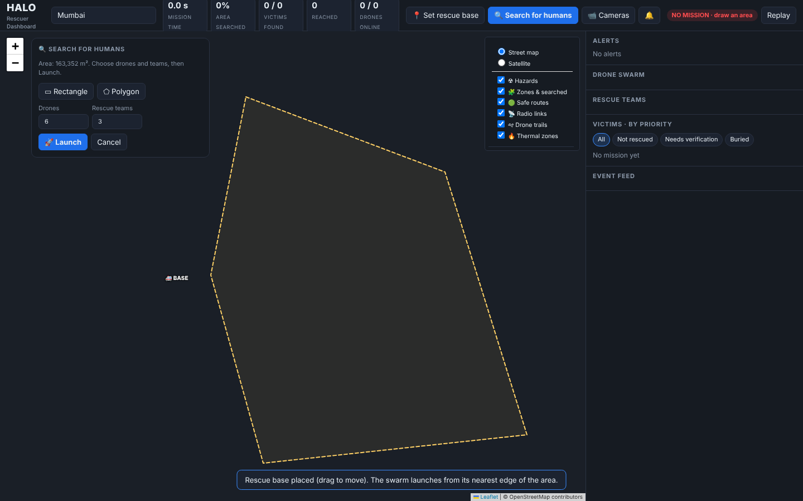
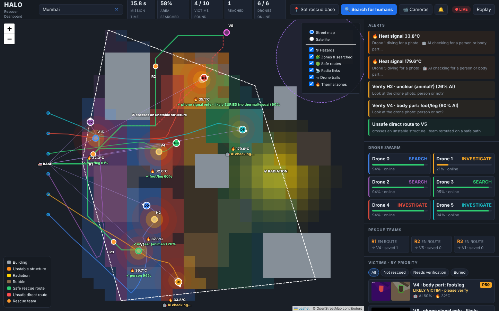
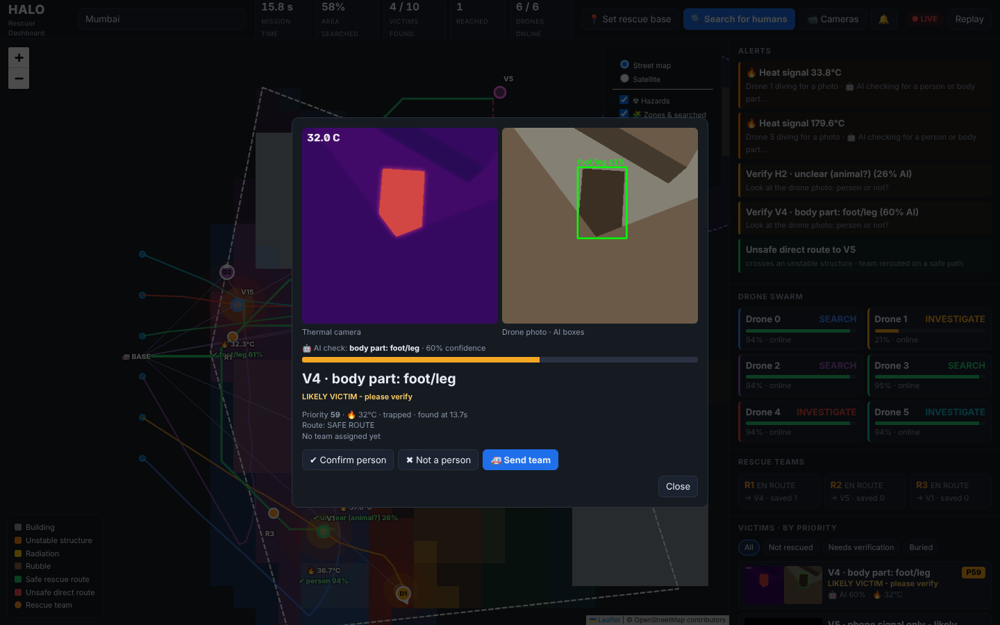
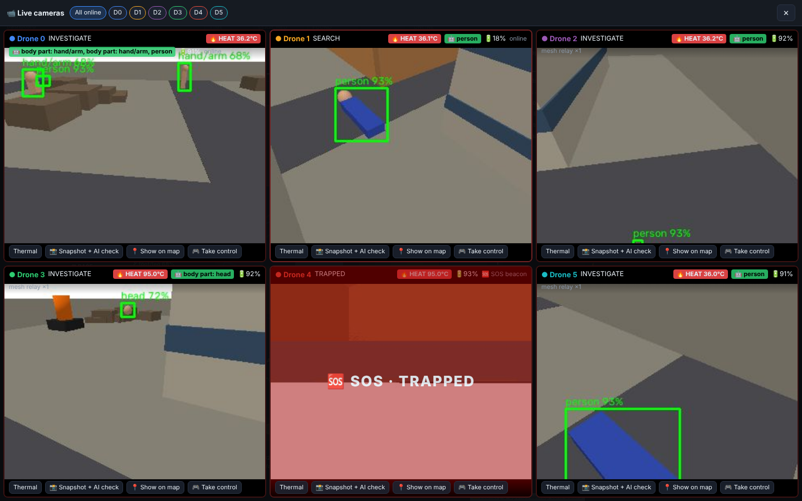

# 🛰️ HALO
### AI-Powered Autonomous Rescue Drone Swarm
**H**azard-**A**ware **L**ifesaving **O**perations

> One swarm for earthquakes, floods and collapsed buildings. HALO finds trapped people, even when only a hand is visible under debris. It maps safe routes for rescuers and keeps searching when a drone goes down, runs out of battery or loses signal.

**Track:** Disaster Management (Robotics + AI) · Physical AI Hackathon: From Simulation to Reality

🎥 **Demo video:** _link coming soon_  ·  📄 **Concept note:** _coming soon_

---

## 🚨 The problem

In the first **72 hours** after a disaster, every minute counts for people trapped under rubble or cut off by floodwater. Rescue teams today:

- search large areas **manually**, zone by zone, which is slow and puts rescuers at risk
- enter structures **without knowing** if they are about to collapse or if there is a radiation hazard
- lose **communication** when mobile networks go down
- miss victims who are **mostly buried**, with only a hand or foot visible
- have no single live map of **where victims are and how to reach them safely**

## 💡 Our solution

HALO is a **swarm of autonomous AI drones**. A rescuer marks an area on the map. The swarm splits it into zones, searches every zone in parallel, finds victims, checks hazards and plots the **safest route** for the rescue team. All of it shows up on a live dashboard.

```
Rescuer marks area ──► Swarm splits into zones ──► Each drone searches its zone
        ▲                                                   │
        │                                                   ▼
  Live dashboard  ◄── Safe route planned ◄── Heat signal → photo → AI check → rescuer verifies
```

---

## ✨ Key features

| # | Feature | What it does |
|---|---------|--------------|
| 1 | 🧩 **Smart zone splitting** | Rescuer marks an area, and the swarm divides it evenly so each drone owns one zone. |
| 2 | 🔁 **Self-healing swarm** | If a drone fails, runs low on battery or gets trapped, the remaining drones **re-split its zone automatically**. Nothing is left unsearched. |
| 3 | 🔋 **Auto return-to-charge & handover** | Low battery → drone flies back to the charging base, recharges and rejoins, then the swarm rebalances. |
| 4 | 🌡️ **Thermal victim detection** | Drones scan for body-heat signatures. |
| 5 | 📸 **AI photo verification (human in the loop)** | On any unusual heat signal, the drone **takes a photo** and AI checks for a **whole person or a partial body part** (hand, arm, foot, face) sticking out of debris. **No heat signal is ever thrown away**: uncertain ones are sent as *"possible victim, please verify"*. A missed victim is treated as far worse than a false alarm. |
| 6 | 📶 **Phone-signal victim locating** | Detects Wi-Fi / Bluetooth signals from trapped people's phones to estimate their position, even with **no line of sight**. |
| 7 | 🚦 **Victim priority scoring** | Ranks victims by urgency (body heat, AI confidence, nearby hazards) so rescuers reach the most critical first. |
| 8 | ☢️ **Hazard sensing** | Radiation and structural-integrity scanning flag dangerous zones **before** rescuers enter. |
| 9 | 🗺️ **Safe-route planning** | Hazard-weighted path planning for rescuers. If the direct route is unsafe, HALO **reroutes** and still marks the victim's location. |
| 10 | 🆘 **Drone distress beacon** | If a drone is trapped (e.g. inside a building that collapses), it broadcasts an **SOS with its last known position** so the team can recover it, and the swarm takes over its zone. |
| 11 | 🧠 **Edge autonomy (multi-agent AI)** | A central command AI talks to rescuers, and **each drone runs its own AI agent**. If debris cuts the signal, drones keep working on their own and sync when they reconnect. |
| 12 | 🚧 **Obstacle & collision avoidance** | Drones avoid buildings, debris and each other. |
| 13 | 📦 **Relief drops** | Light payloads (medicine, water pouches, a radio) delivered to victims waiting for rescue. Especially useful in **floods**. |
| 14 | 🖥️ **Live rescuer dashboard** | Map with thermal red zones, live AI verdicts, victims with thermal + photo, hazards, drones, rescue teams and safe routes. |
| 15 | 🚑 **Rescue team dispatch** | Command AI sends ground teams to victims by priority along safe routes. Uncertain photos are verified by a human first. |

---

## 🏗️ Architecture

```
                    ┌─────────────────────────────┐
   Rescuer  ◄────►  │   HALO Command AI (central) │  ◄────►  Live Dashboard
                    │ zones · alerts · re-tasking │
                    └──────────────┬──────────────┘
                     mesh / radio  │  (may drop out)
          ┌────────────────┬───────┴────────┬────────────────┐
     ┌────▼────┐      ┌────▼────┐      ┌────▼────┐      ┌────▼────┐
     │ Drone 1 │      │ Drone 2 │      │ Drone 3 │      │ Drone N │
     │ AI agent│      │ AI agent│      │ AI agent│      │ AI agent│
     └─────────┘      └─────────┘      └─────────┘      └─────────┘
   Perceive: thermal · camera · phone signal · radiation · structure · obstacles
   Decide:   search path · victim check & scoring · battery · avoid collisions
   Act:      fly · photograph · return to charge · SOS beacon · drop relief · report
```

---

## 🧪 Simulation

Built on **PyBullet** with **gym-pybullet-drones** quadcopter physics. Details and run instructions are in [`simulation/`](simulation/).

**Demo scenario:** earthquake hits a city block → rescuer marks the area → 6 drones split into zones → heat signals photographed and AI-checked → one drone returns to recharge and the swarm self-heals → a drone gets trapped and sends SOS → signal drops and drones keep working on their own → 3 rescue teams follow safe routes to all 20 victims, most urgent first.

## 📊 Results

From the PyBullet simulation: **6 drones**, **20 hidden victims** (7 only partly visible, 3 fully buried), **3 heat decoys** and **3 ground rescue teams** in an earthquake-hit block. It's a 12 m scale model of a ~100 m block. Reproduce it with `python simulation/run_mission.py`.

| Metric | Result |
|--------|--------|
| Victims found | **20 / 20** |
| Partial-body victims found (hand, foot, head) | **7 / 7** |
| Buried victims found only by phone signal | **3 / 3** |
| Heat signals discarded by AI | **0**. All 3 decoys went to a rescuer, who dismissed them from the photo |
| Victims reached by rescue teams | **20 / 20** |
| Avg time from detection to a rescue team reaching the victim | **70 s** |
| Area searched | **100%** in 104 s, despite 1 drone trapped and 1 recharging |
| Unsafe direct routes caught and rerouted | **3** (radiation zone / collapsed building) |
| Phone location error | **0.1 – 0.64 m** |

**Swarm vs single drone** (same scene, no aftershock):

| | 6-drone swarm | 1 drone |
|---|---|---|
| Time to search the whole area | **98 s** | 298 s |
| Time to find all visible victims | **64 s** | 203 s |

→ The swarm finds every victim about **3.2× faster**.


🎬 Simulation recording: [`simulation/results/halo_demo.mp4`](simulation/results/halo_demo.mp4)

## 🖥️ Rescuer dashboard

A live web dashboard for the rescue team that also installs as a phone app. It runs and stores everything locally (`simulation/results/`), with no cloud and no API keys.

```bash
python dashboard/serve.py            # opens http://localhost:8000/dashboard/ and prints the address for phones
python dashboard/serve.py --replay   # replay the last mission
```

**Search for humans in 5 clicks:** search a place (e.g. *Mumbai*) → **📍 Set rescue base** → **🔍 Search for humans** → draw the disaster area (rectangle or polygon), pick the number of drones and rescue teams → **🚀 Launch**. The server fits the simulation onto that area and starts it. Then watch it live:

| | What you get |
|---|---|
| 🗺️ **Real map + place search** | OpenStreetMap streets and Esri satellite layers, opens on India, zoom anywhere. Place search uses the free OpenStreetMap Nominatim geocoder |
| 🧩 **Live mission on the map** | Zones split in each drone's colour, filling in as they're searched · each drone's **flight path draws as it flies** · **🔥 thermal red zones** with *"🤖 AI checking…"* → AI verdict · **green safe rescuer routes** from the base to each victim (unsafe direct routes as red dashed lines, with the reason) · rescue teams walking their routes · a **mission summary card** at the end |
| 🧍 **Victims & AI verification** | List sorted by priority with thermal image, photo with the AI's boxes, confidence, temperature, status and team. Click one to **✔ Confirm person / ✖ Not a person** or **🚑 Send team**. Filters: not rescued yet / needs verification / buried (phone signal) |
| 🛩 **Drones** | Battery, state, signal (online / mesh relay / offline-autonomous), SOS. Click one for details, trail on/off and **↩ Recall to base** |
| 📹 **Live camera wall** | Watch one, several or *All online* drones in an auto grid (1 / 2 / 2×2 / 3×2). Each tile shows name, state, battery and signal, has a **Normal / Thermal** toggle, AI boxes on people or body parts, and flashes red when it sees heat. Tile buttons: **📸 Snapshot + AI check**, **📍 Show on map**, **🎮 Take control**. Offline drones show *NO SIGNAL* with their last frame; a trapped drone shows a red SOS tile. Watching never changes what a drone does. Cameras are rendered only for drones being watched (320×240, up to 4 fps), in background processes, so watching never slows the mission |
| 🎮 **Manual drone takeover** | Fly a drone with the keyboard (**W/A/S/D** move, **Q/E** rotate, **R/F** up/down), the on-screen joysticks or a gamepad, with its live camera. The rest of the swarm re-splits its zone. **Anti-crash safety stays on:** your input is only a desired velocity, and obstacle avoidance, drone avoidance and the geofence still apply (*"⚠ Obstacle ahead"* shows when it steps in). The battery failsafe still forces a return home. **Release control**, or 2 s without input, hands it back to the AI and the swarm re-balances |
| 🚨 **Alerts, layers, replay** | Banner + sound (mute toggle) for drone SOS, heat signals being checked, photos needing verification and unsafe routes. Layer toggles for thermal zones, trails, zones, safe routes, radio links and hazards. Event feed and **mission replay with a timeline scrubber** |
| 📱 **Phone app (PWA)** | *Add to Home Screen* on Android and iPhone opens it full screen like an app. On a phone the map is full screen, panels become bottom tabs (Alerts, Drones, Victims, Teams, Cameras), the camera wall becomes a swipe carousel and the joysticks are touch-friendly. `serve.py` listens on the local network, so phones on the same Wi-Fi can open it |

| Draw the area | Live mission | Victim check |
|---|---|---|
|  |  |  |
| **Camera wall** | **Manual control** | **Phone app** |
|  |  |  |

<sub>Screenshots were taken offline, so the street and satellite map tiles are missing. They load normally with an internet connection.</sub>

**Backend API** (`dashboard/serve.py`, Python standard library only): `GET /` dashboard · `POST /api/mission` · `POST /api/verify` · `POST /api/command` · `POST /api/control` · `POST /api/watch` · `GET /api/cam/<N>` (MJPEG stream, e.g. for VLC; the dashboard itself polls the JPEG frames so it never runs out of browser connections). Commands are written to `simulation/results/commands.json`, which the running simulation polls and acts on (drone commands travel over the mesh, so an offline drone gets them when it reconnects).

> Phones only allow a full app install (service worker) over HTTPS or on `localhost`. Over plain `http://<laptop-ip>:8000` you can still add it to the home screen. For the full install, serve with a certificate: `python dashboard/serve.py --cert cert.pem --key key.pem`.

## ✅ Tests

```bash
pip install -r simulation/requirements.txt
python -m pytest tests          # area fitting, command queue, anti-crash safety filter, area mask, base placement
```

The anti-crash tests fly a simulated drone at full speed into a wall and at another drone, and check that it always stops at the safety margin (0.4 m to obstacles, 0.5 m to drones) and stays inside the altitude geofence. The dashboard was tested end to end in a headless browser: search a place → set base → draw the area → launch → camera wall and snapshot → manual flight and release → photo verification → mission summary.

## 🔧 From simulation to reality

| Simulated | Real hardware |
|-----------|---------------|
| Quadcopter model (Crazyflie in gym-pybullet-drones) | Quadcopter with flight controller (PX4 / ArduPilot) |
| Simulated thermal camera | Thermal camera module (e.g. FLIR Lepton) |
| Simulated RGB photo + AI check | Onboard camera + person / body-part detection model |
| Simulated phone-signal sensing | Wi-Fi / BLE scanner module (e.g. ESP32) |
| Simulated radiation field | Geiger counter module |
| Drone-to-drone comms | ESP-NOW / LoRa mesh radio |
| Onboard AI agent | Raspberry Pi / Jetson Nano companion computer |
| Charging base | Landing pad with charging contacts |

---

## 🔭 Future scope

CO₂ breath detection under rubble · acoustic sensing (tapping / voices) · aftershock & collapse prediction · two-way voice beacon for trapped victims · cloud dashboard for multiple rescue teams.

## 🙏 Credits

- [gym-pybullet-drones](https://github.com/utiasDSL/gym-pybullet-drones) by the Learning Systems & Robotics Lab (University of Toronto), used as the drone physics base, MIT License.
- [PyBullet](https://pybullet.org) physics engine.

## 👥 Team

_Team members coming soon._
