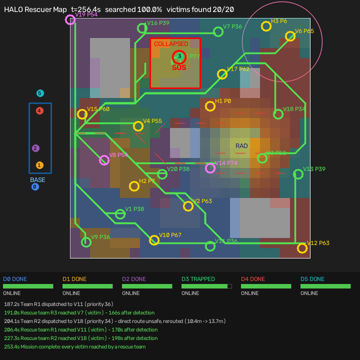

<div align="center">

# 🛰️ HALO
### Hazard-Aware Lifesaving Operations
**An AI-powered autonomous drone swarm that finds trapped people after disasters and guides rescuers to them safely.**


*Physical AI Hackathon: From Simulation to Reality · Disaster Management (Robotics + AI)*

[Demo video](#-demo) · [Results](#-results) · [Features](#-features) · [Architecture](#-architecture) · [Quick start](#-quick-start) · [Sim-to-real](#-from-simulation-to-reality)

</div>

---

## 🚨 The problem

The first **72 hours** after an earthquake, flood or building collapse decide who survives. Yet search and rescue is still mostly manual:

- Teams search **zone by zone on foot**, which is slow and dangerous.
- Survivors are often **mostly buried**, with only a hand or foot visible, or not visible at all.
- Rescuers enter areas **without knowing** about radiation, unstable structures or the safest way in.
- **Mobile networks fail**, cutting communication when it matters most.

## 💡 The solution

**HALO turns a fleet of drones into a coordinated search team.** A rescuer draws the disaster area on a map and presses **Search for humans**. The swarm splits the area, searches it in parallel, and confirms every heat signal with AI. It then plots a **hazard-free route** to each victim and dispatches ground teams, most urgent first. Everything appears live on a dashboard that runs on a laptop or as an app on a phone.

```
 Draw area ─► Fleet pre-flight check ─► Swarm splits zones ─► Parallel search
                                                                   │
 Teams reach victims ◄─ Safe routes planned ◄─ AI verifies ◄─ Heat / phone signal
```

---

## 🎬 Demo

| Simulation (PyBullet) + live rescuer map | |
|---|---|
| 🎥 Full recording | [`simulation/results/halo_demo.mp4`](simulation/results/halo_demo.mp4) |
| 📹 Pitch video | _link coming soon_ |



---

## 📊 Results

Simulated earthquake-hit city block (~100 m, at 1:8 scale): **20 hidden victims (7 partly buried, 3 fully buried) · 3 heat decoys · 3 rescue teams**. HALO supports **any number of drones, from 1 to N**. This benchmark run used a swarm of 6.

<div align="center">

| 🎯 Victims found | 🚑 Reached by teams | 🗑️ Signals discarded | ⚡ vs single drone |
|:---:|:---:|:---:|:---:|
| **20 / 20** | **20 / 20** | **0** | **3.2× faster** |

</div>

| Metric | Result |
|---|---|
| Partial-body victims found (hand / foot / head) | **7 / 7** |
| Buried victims found by phone signal only | **3 / 3** |
| Heat decoys | **3 / 3** sent to a rescuer and dismissed from the photo |
| Area searched | **100%** in 104 s, despite one drone trapped and one recharging |
| Avg. time from detection to a team reaching the victim | **72 s** |
| Unsafe direct routes detected and rerouted | **3** |
| Phone-signal location error | **0.0 – 0.64 m** |

**Swarm vs single drone** (same scene): full search **98 s vs 298 s**, all visible victims found **64 s vs 203 s**.

---

## ✨ Features

### 🤖 Autonomous swarm intelligence
| Feature | Description |
|---|---|
| **Multi-agent AI** | A central **Command AI** coordinates the mission, and every drone runs its **own AI agent**, so each drone keeps working if the link drops. |
| **Scales to any fleet size** | Add drones from 1 to N. The area is divided evenly and matched to drones optimally (Hungarian algorithm), and new drones can join mid-mission. |
| **Self-healing swarm** | When a drone is lost, trapped, recharging or added mid-mission, unsearched areas are **re-split automatically**. |
| **Auto return-to-charge** | Each drone calculates when it must fly home, recharges, and rejoins the search. |
| **Collision-free flight** | A **SafetyLayer** on every drone: obstacle sensing, drone-to-drone avoidance (ORCA), geofence, emergency landing. It stays on even under manual control. |
| **Edge autonomy + mesh relay** | Out of radio range, drones relay through each other. In dead zones they search on their own and sync when they reconnect. |
| **Drone SOS beacon** | A trapped or crashed drone broadcasts its last position for recovery. The swarm takes over its zone. |

### 🔍 Victim detection
| Feature | Description |
|---|---|
| **Thermal detection** | Every unusual heat signal is investigated. |
| **AI photo verification** | The drone photographs each heat signal. **YOLOv8** checks for a whole person **or a partial body part** sticking out of rubble. |
| **Never discards a signal** | Low-confidence results go to a rescuer to verify. A missed victim is treated as far worse than a false alarm. |
| **Phone-signal locating** | Finds **buried survivors with no heat or visual contact** from their phones' Wi-Fi/Bluetooth signals. |
| **Priority scoring** | Ranks victims by urgency (certainty, how trapped they are, hazards nearby, body temperature). |

### 🗺️ Rescue guidance
| Feature | Description |
|---|---|
| **Hazard mapping** | Radiation, unstable structures, rubble and no-signal zones. |
| **Safe-route planning** | Hazard-weighted routes for rescuers. Unsafe direct routes are detected and **rerouted**. |
| **Rescue team dispatch** | Ground teams are sent to the most urgent victims along safe routes. |
| **Relief drops** | Light payloads (medicine, water, radio) for victims waiting for rescue, especially in floods. |

### 🖥️ Rescuer dashboard (web + installable phone app)
| Feature | Description |
|---|---|
| **Fleet setup** | Add any number of drones. Each runs a **live pre-flight check** (link, flight controller, motors, battery, RGB camera, thermal camera, obstacle sensors, mesh radio) until it shows **🟢 Ready to fly**. |
| **Real map** | Street and satellite maps of anywhere in the world, with place search. |
| **Search for humans** | Draw the disaster area and launch. Watch zones, **live flight paths**, thermal red zones and **safe routes** draw on the map. |
| **AI verdicts** | Thermal zones show *"AI checking…"* until they turn into confirmed person / body part / not a person, with the thermal image and photo. |
| **📹 Live camera wall** | Watch one, several or all online drones at once (normal or thermal view), with AI boxes on people. |
| **🎮 Manual takeover** | Take control of any drone with keyboard, touch joystick or gamepad. **Anti-crash safety stays on.** |
| **Human-in-the-loop** | Confirm or dismiss victims, send teams, recall drones. |
| **Alerts & replay** | SOS, new victims and verification requests, plus a full mission replay with a timeline. |
| **Installable app (PWA)** | Add to the home screen on Android or iPhone. Works on laptops, tablets and phones. |
| **Local-first** | All data stays on the rescue team's device. No cloud needed in the field. |

---

## 🏗️ Architecture

```
                         ┌──────────────────────────────┐
  Rescuer (web / phone) ◄►│  HALO Command AI  (base)     │
                         │  zones · priorities · teams  │
                         └──────────────┬───────────────┘
                          mesh radio    │   (may drop out)
          ┌──────────────┬──────────────┼──────────────┬──────────────┐
     ┌────▼────┐    ┌────▼────┐    ┌────▼────┐    ┌────▼────┐    ┌────▼────┐
     │ Agent 1 │    │ Agent 2 │    │ Agent 3 │    │ Agent 4 │    │ Agent N │
     └────┬────┘    └─────────┘    └─────────┘    └─────────┘    └─────────┘
          │  Perceive → Decide → SafetyLayer → Act
          ▼
   Thermal · RGB camera · Wi-Fi/BLE scanner · rangefinders · radiation sensor
```

| Layer | Responsibility |
|---|---|
| `halo/` | Hardware-independent AI: agents, Command AI, SafetyLayer, planning, perception, comms |
| `hal/` | Hardware abstraction: **PyBullet** backend now, **PX4 / MAVSDK** backend for real drones |
| `simulation/` | Disaster scene, mission runner, video and metrics |
| `dashboard/` | Rescuer web app + local server |

---

## 🚀 Quick start

```bash
git clone https://github.com/iamjyotirmayroy-art/HALO.git && cd HALO
pip install -r simulation/requirements.txt     # PyBullet compiles on first install

python simulation/run_mission.py --gui         # run a mission in the 3D simulator
python dashboard/serve.py                      # open the rescuer dashboard → http://localhost:8000/dashboard/
```

More options: `simulation/README.md`.

---

## 🔧 From simulation to reality

| Simulated | Real hardware |
|---|---|
| Crazyflie quadcopter model | Quadcopter with PX4 / ArduPilot flight controller |
| Rendered RGB camera + YOLOv8 | Onboard camera + YOLOv8 on a Jetson / Raspberry Pi |
| Simulated thermal camera | FLIR Lepton thermal module |
| Simulated rangefinders | ToF / LiDAR obstacle sensors |
| Phone-signal model | ESP32 Wi-Fi / BLE scanner |
| Radiation field | Geiger counter module |
| Mesh network model | ESP-NOW / LoRa mesh radio |
| Charging pads | Landing pads with charging contacts |

The control AI talks to drones only through the `hal/` interface, so **the same code flies simulated and real drones**.

---

## 🧭 Development status

| Component | Status |
|---|---|
| Swarm AI, zone splitting, self-healing, battery return, SOS, mesh relay | ✅ Done (simulation) |
| Thermal + phone-signal detection, priority scoring, safe routes, rescue teams | ✅ Done (simulation) |
| Rescuer dashboard: map, thermal zones, victims, alerts, replay | ✅ Done |
| SafetyLayer with ORCA + rangefinder sensing, 0-collision test suite | 🚧 In progress |
| YOLOv8 photo verification (people + body parts) | 🚧 In progress |
| Dashboard: fleet setup, Search for humans, camera wall, manual takeover, PWA | 🚧 In progress |
| Relief drops, real-hardware backend (PX4) | 🔜 Planned |

> **Note on the simulation:** photos and thermal frames are rendered from the 3D scene. The aftershock is a scripted event, and charging is sped up for the demo.

---

## 🔭 Future scope
CO₂ breath detection under rubble · acoustic sensing for tapping and voices · aftershock and collapse prediction · two-way voice beacon for trapped victims · cloud sync for multiple rescue agencies.

## 🙏 Acknowledgements
- [gym-pybullet-drones](https://github.com/utiasDSL/gym-pybullet-drones) (University of Toronto, MIT License): drone physics and flight control
- [PyBullet](https://pybullet.org) physics engine · [Ultralytics YOLOv8](https://github.com/ultralytics/ultralytics) (AGPL-3.0)
- [Leaflet](https://leafletjs.com) · map data © [OpenStreetMap](https://www.openstreetmap.org/copyright) contributors · imagery © Esri

## 👥 Team
_Coming soon._

<div align="center"><sub>Built to save lives in the first 72 hours.</sub></div>
